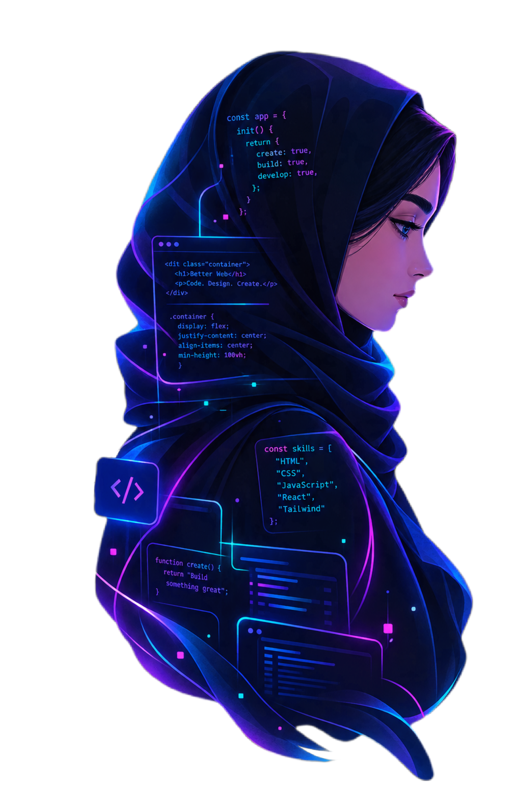

# Hi, I'm Fatemeh 👋

### Front-End Designer

I design modern, responsive interfaces and bring them to life with code.

---

  

 

## 🛠️ Tech Stack

  

## 🚀 Featured Projects

### 🛍️ Fashion Shop

A responsive clothing e-commerce website focused on modern UI,
responsive layouts and interactive front-end elements.

**Built with:** HTML · CSS · JavaScript

---

### 🎨 <a href="https://mahdyarqzv005-byte.github.io/MgArts/">Portfolio Website</a>

A responsive portfolio website designed and developed for a 3D artist.

**Built with:** HTML · CSS

---

## 🌐 Connect With Me

**Telegram:**  
[@Hwi38wj](https://t.me/Hwi38wj)

**Instagram:**  
[@fate.mehdev](https://instagram.com/fate.mehdev)

 

<h3 align="center">📊 آمار و فعالیت‌های من در گیت‌هاب</h3>

  
  

  <!-- آدرس جدید و درست Streak -->
  

  

> Designing with purpose. Building with code. ✨
